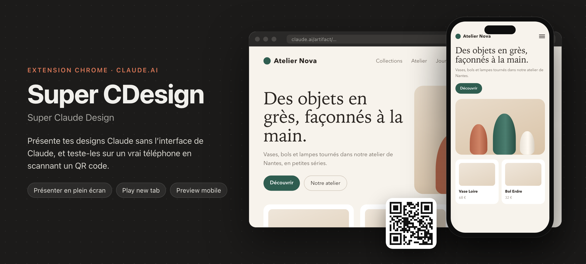
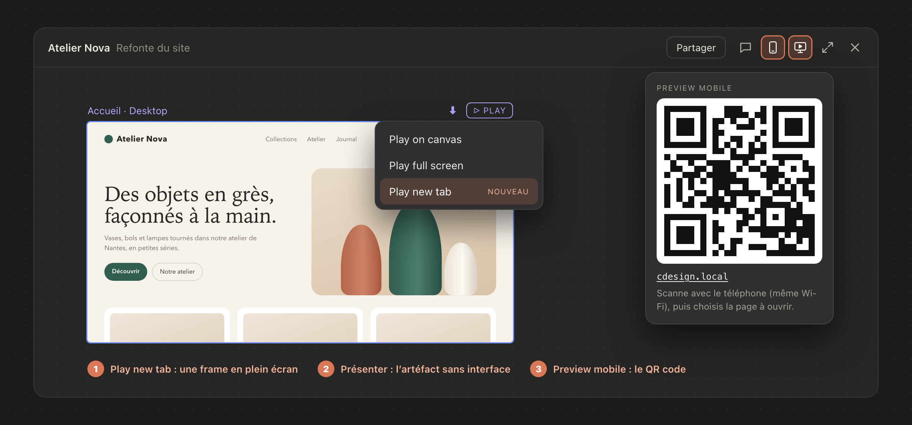
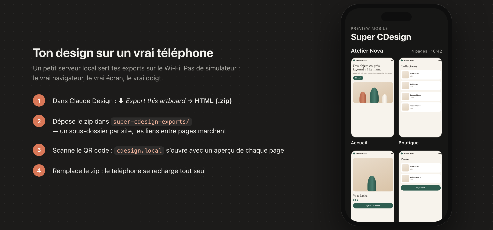

# Super CDesign

<p align="center"></p>

**Super Claude Design** : une extension Chrome pour présenter un design fait avec Claude sans l'interface de Claude, et le tester sur un vrai téléphone en scannant un QR code.

> ⚠️ **Fonctionne uniquement avec la version web de Claude** ([claude.ai](https://claude.ai) dans Chrome). L'application de bureau Claude (Mac / Windows) et les applications mobiles ne chargent pas les extensions Chrome.

> Projet personnel, non officiel, sans lien avec Anthropic. Il s'appuie sur l'interface actuelle de claude.ai et peut cesser de fonctionner si elle change.

## 🚀 Installation rapide

Laisse une IA l'installer pour toi :

<p align="center">
  <a href="https://claude.ai/new?q=Installe%20Super%20CDesign%20%28Super%20Claude%20Design%2C%20une%20extension%20Chrome%20pour%20claude.ai%29%20pour%20moi.%20Suis%20le%20guide%20%C3%A9crit%20pour%20les%20assistants%20IA%20%3A%20https%3A%2F%2Fraw.githubusercontent.com%2Ftheolg29%2Fsuper-cdesign%2Fmain%2FINSTALL.md%20%E2%80%94%20commence%20par%20me%20demander%20o%C3%B9%20l%27installer."></a>
  &nbsp;
  <a href="https://chatgpt.com/?q=Installe%20Super%20CDesign%20%28Super%20Claude%20Design%2C%20une%20extension%20Chrome%20pour%20claude.ai%29%20pour%20moi.%20Suis%20le%20guide%20%C3%A9crit%20pour%20les%20assistants%20IA%20%3A%20https%3A%2F%2Fraw.githubusercontent.com%2Ftheolg29%2Fsuper-cdesign%2Fmain%2FINSTALL.md%20%E2%80%94%20commence%20par%20me%20demander%20o%C3%B9%20l%27installer."></a>
</p>

Ou colle ceci dans Claude Code, Codex ou Cursor, qui exécutent les commandes à ta place :

```text
Installe Super CDesign (Super Claude Design, une extension Chrome pour claude.ai) pour moi. Suis le guide écrit pour les assistants IA : https://raw.githubusercontent.com/theolg29/super-cdesign/main/INSTALL.md — commence par me demander où l'installer.
```

L'assistant te demande d'abord où installer le projet, puis suit [`INSTALL.md`](INSTALL.md). Dans Claude ou ChatGPT sur le navigateur, il te guide étape par étape et c'est toi qui lances les commandes. Le chargement de l'extension dans Chrome se fait toujours à la main (`chrome://extensions`).

## Pourquoi

Depuis que Claude Design s'affiche dans les artéfacts, présenter un site à un client montre aussi les barres de Claude (en-tête, barre du viewer, « Fill / Fit »…). Et les simulateurs de téléphone ne remplacent pas un test sur un vrai téléphone.

## Fonctionnalités

<p align="center"></p>

### Présenter sans l'interface Claude
- **Bouton « Présenter »** dans l'en-tête du panneau d'artéfact (à côté de Partager / Développer) : ouvre l'artéfact publié dans un nouvel onglet, en plein écran, **sans aucune barre de Claude**.
- **« Play new tab »** dans le menu **PLAY** de chaque frame du canvas (à côté de « Play on canvas » et « Play full screen ») : ouvre directement cette frame en plein écran dans un nouvel onglet, sans interface.

Le bouton et l'option n'apparaissent que pour un artéfact **publié** (il faut un lien `claude.ai/artifact/…`).

### Preview mobile sur un vrai téléphone

<p align="center"></p>

- Un **petit serveur local** sert sur ton Wi-Fi les exports HTML de tes designs.
- Le **bouton téléphone** dans l'en-tête du panneau d'artéfact affiche son **QR code** : scanne-le avec l'appareil photo du téléphone. L'adresse est simplement **`http://cdesign.local/`**.
- Sur le téléphone, l'accueil montre **tes projets avec un aperçu de chaque page** ; touche une page pour l'ouvrir en plein écran.
- **Les liens entre pages fonctionnent** quand les pages sont dans le même projet.
- Quand tu remplaces un export, **le téléphone se recharge tout seul**.

Rien n'est automatisé dans Claude : c'est toi qui exportes, avec le bouton natif. Le serveur ne fait que lire un dossier sur ton ordinateur, et rien ne sort de ton réseau local.

## Installation manuelle

### 1. L'extension

1. Télécharge ce dépôt (`git clone` ou **Code → Download ZIP**, puis décompresse).
2. Ouvre `chrome://extensions` dans Chrome.
3. Active le **Mode développeur** (en haut à droite).
4. Clique sur **Charger l'extension non empaquetée** et choisis le dossier du dépôt (celui qui contient `manifest.json`).
5. Recharge tes onglets claude.ai.

### 2. Le serveur de preview mobile (facultatif)

Il faut [Node.js](https://nodejs.org) 18 ou plus récent.

```bash
cd server
npm install
npm start
```

Le terminal affiche l'adresse du serveur, **`http://cdesign.local/`** (et l'adresse IP en secours), et le dossier surveillé : `super-cdesign-exports/`, à la racine du projet (créé au premier lancement). Laisse le terminal ouvert.

- Pour surveiller un autre dossier : `SUPERDESIGN_DIR=/chemin/vers/dossier npm start`.
- Le serveur s'annonce sur le Wi-Fi sous le nom `cdesign.local` (Bonjour / mDNS). Pour un autre nom : `SUPERDESIGN_HOST=monnom npm start` → `monnom.local`.
- Il écoute sur le port 4321 et, quand c'est possible (macOS, Windows), aussi sur le port 80 : d'où l'adresse sans `:4321`. Sous Linux, ce sera `http://cdesign.local:4321/`.
- iPhone, Mac, Windows et Linux reconnaissent les adresses en `.local`. Certains Android non : utilise alors l'adresse IP affichée en secours (dans le terminal et sous le QR code).
- Pour changer de port : `PORT=5000 npm start` (le bouton de l'extension attend le port 4321).
- Au premier lancement, macOS peut demander d'autoriser les connexions entrantes pour `node` : accepte, c'est ce qui permet au téléphone de joindre l'ordinateur.

Le serveur tourne sur macOS, Linux et Windows 10+ (il utilise `unzip`, ou `tar` sur Windows).

## Utilisation de la preview mobile

1. Dans Claude Design, sur la frame voulue : **⬇ Export this artboard → HTML (.zip)**, puis enregistre le fichier.
2. Dépose le zip dans le dossier `super-cdesign-exports/` du projet :
   - un zip à la racine = un projet d'une page ;
   - **un sous-dossier = un projet de plusieurs pages** (par ex. `super-cdesign-exports/MonSite/` avec l'export de l'accueil, de la boutique, du paiement…). Les pages y sont réunies : les liens entre elles fonctionnent.
3. Clique sur le **bouton téléphone** dans l'en-tête du panneau d'artéfact et scanne le QR code. Le téléphone doit être sur **le même Wi-Fi** que l'ordinateur.
4. Pour mettre à jour : réexporte la frame et remplace le zip dans le dossier. La page ouverte sur le téléphone se recharge seule.

Un lien vers une page pas encore exportée affiche un écran d'explication, qui se met à jour dès que le zip arrive.

## Comment ça marche

- `content.js` tourne sur claude.ai et dans l'iframe du viewer de Claude Design. Il ajoute les boutons, masque les barres de Claude dans l'onglet de présentation et ajoute « Play new tab » au menu PLAY. Les deux contextes communiquent par `postMessage` (origines vérifiées).
- `background.js` récupère le QR code auprès du serveur local : seul le service worker de l'extension peut joindre `localhost` depuis claude.ai.
- `server/server.mjs` surveille le dossier, décompresse les exports, ajoute la balise `viewport` qui manque aux exports (sinon le téléphone affiche la version ordinateur rétrécie), et injecte un petit script de rechargement automatique.

Le dossier `super-cdesign-exports/` et le cache du serveur (`server/.cache/`) sont exclus de git : tes designs ne partent jamais dans le dépôt.

Les détails techniques, et les pièges de l'interface de Claude, sont dans [`CLAUDE.md`](CLAUDE.md).

## Limites

- Version web de claude.ai dans Chrome uniquement (ou un navigateur Chromium qui accepte les extensions non empaquetées).
- Dépend de l'interface actuelle de Claude : si Anthropic la modifie, les boutons ou « Play new tab » peuvent disparaître jusqu'à une mise à jour.
- La preview mobile ne fonctionne que sur le réseau local, et seulement pendant que le serveur tourne.
- Les exports sont des copies : après une modification du design, il faut réexporter.

## Licence

[MIT](LICENSE).
